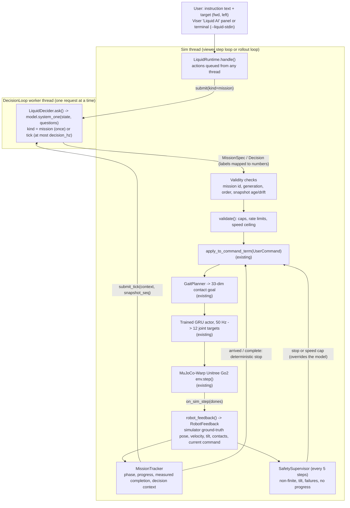

# Learning to Act Through Contact (mjlab) + Liquid AI closed-loop runtime

This repository has two layers:

1. **The RL locomotion project** (pre-existing). This implements
   *Learning to Act Through Contact: A Unified View of Multi-Task Robot
   Learning* (Shafeef Omar, Majid Khadiv, TUM, L4DC 2026, arXiv:2510.03599v2)
   on top of [mjlab](https://github.com/mujocolab/mjlab), an Isaac-Lab-style,
   manager-based RL framework running on MuJoCo-Warp. A recurrent (GRU) PPO
   policy drives a simulated **Unitree Go2**. The policy is conditioned on
   *contact goals*, which a `GaitPlanner` generates from a gait / speed /
   direction / yaw-rate command.
2. **An optional Liquid AI runtime** (branch `feature/liquid-ai-runtime`).
   A local decision model, `LiquidAI/d1-3B-w8a8`, reads a human instruction
   such as *"Move toward the target and turn left."* and turns it into a
   persistent **mission**. While the robot walks, the model re-decides the
   **high-level command** (speed, steering, gait, mission status) about once
   per second from fresh robot feedback. Deterministic code validates every
   answer, enforces safety and decides when the mission is really complete.
   The existing `GaitPlanner` and trained GRU policy still do all of the
   locomotion.

The Liquid model **never controls joints**. Its output is a choice among
named options, such as `speed: increase` or `steer: left`. The runtime turns
these into a validated `UserCommand` and hands it to the existing
`apply_to_command_term`, which is the same entry point as the viewer's
manual "Contact control" panel.

> **Status in one sentence:** the closed-loop runtime is implemented and
> tested against the real simulator and the real locomotion checkpoint, but
> **only with a mock decider standing in for the Liquid model**. The real
> model has not run yet, because no compatible GPU was available (see the
> [verification matrix](#2-current-status-and-verification-matrix)).

Detailed design notes: [`docs/liquid_runtime.md`](docs/liquid_runtime.md).
Paper / code gap analysis: [`docs/AUDIT.md`](docs/AUDIT.md). Condensed map of
the code for contributors: [`CLAUDE.md`](CLAUDE.md).

## Contents

1. [Project overview](#1-project-overview)
2. [Current status and verification matrix](#2-current-status-and-verification-matrix)
3. [What changed and why](#3-what-changed-and-why)
4. [Architecture](#4-architecture)
5. [Prerequisites and hardware requirements](#5-prerequisites-and-hardware-requirements)
6. [Installation](#6-installation)
7. [Model and checkpoint setup](#7-model-and-checkpoint-setup)
8. [Quick start: viewer](#8-quick-start-viewer)
9. [Closed-loop mission workflow](#9-closed-loop-mission-workflow)
10. [Headless rollouts](#10-headless-rollouts)
11. [Tests and benchmarks](#11-tests-and-benchmarks)
12. [Configuration reference](#12-configuration-reference)
13. [Safety and known limitations](#13-safety-and-known-limitations)
14. [Troubleshooting](#14-troubleshooting)
15. [Repository structure](#15-repository-structure)
16. [Next steps](#16-next-steps)
17. [RL project reference (training, evaluation, checkpoints, VPS)](#rl-project-reference)

---

## 1. Project overview

### The locomotion stack (pre-existing, unchanged by the Liquid runtime)

The policy is conditioned on **contact goals**: where and when each foot
should make or break contact. It does not take velocity targets or reference
motions. One reward formulation (reach / hold / detach) covers a whole family
of gaits. Scope: **Unitree Go2**, flat terrain, five gaits (trot, pace, bound,
jump, crawl).

| Task id | What |
| --- | --- |
| `Mjlab-Contact-Flat-Unitree-Go2` | Paper-faithful implementation (default). Runs under `runs/go2_contact/`. |
| `Mjlab-Contact-Flat-Unitree-Go2-Improved` | **Experimental**: adds IMU signals (base angular velocity, projected gravity) to the actor and running observation normalisation on actor *and* critic. Runs under `runs/go2_contact_improved/`. |

These were measured by the headless rollout on the default task:

- The RL policy runs at **50 Hz** (`policy_hz_sim: 50.0` in the rollout report).
- Actor observation: `[1, 81]`. Critic observation: `[1, 94]`.
- Action: `[1, 12]` joint position offsets.
- GRU hidden state: `[1, 1, 256]`.
- Contact goal: 33 dimensions.

The Liquid runtime does not change any of these shapes. The rollout report
checks this (`interfaces.unchanged`).

Code layout: task and MDP code under `src/contact_rl/tasks/contact/`; a project
runner (`config/go2/runner.py`: entropy decay, checkpoint management, ONNX
export, graceful stop); six CLIs under `src/contact_rl/scripts/`, with
shared utilities in `src/contact_rl/utils/`. Method details (contact goal,
rewards, PPO settings, posture terms) are in the
[RL project reference](#rl-project-reference).

### The Liquid AI runtime (this branch)

| Layer | Model-driven or deterministic | What it does |
| --- | --- | --- |
| Mission interpretation | **Model** (`system_one`, once per instruction) | Picks the objective (`walk` / `reach_target` / `stop`), speed level, direction, continuous turn, what to do on arrival (`stop` / `turn_left` / `turn_right`), gait, and caution. |
| Periodic decisions ("ticks") | **Model** (`system_one`, at most `--liquid-decision-hz`) | From a JSON summary of measured robot state, picks `speed` (keep / increase / decrease / stop), `steer` (keep / straight / left / right), `gait`, and `status` (continue / complete / abort). |
| Answer → numbers | Deterministic | Maps labels to numbers using the current planner command and fixed steps. For example, `increase` adds 0.05 m/s and `left` means +0.5 rad/s. |
| Validation | Deterministic | `decision_schema.validate`: training-range caps, per-decision rate limits, mission speed ceiling. |
| Staleness / ordering | Deterministic | `DecisionLoop` plus `LiquidRuntime._on_tick_result`: mission generation, request order, snapshot sequence, snapshot age and drift. |
| Safety | Deterministic, takes precedence over the model | `SafetySupervisor`: non-finite state, tilt, repeated inference failures, no valid decision, no progress. |
| Completion | Deterministic, from measurements | `MissionTracker`. The model can *say* "complete", but this is accepted only when the measurements confirm it. |
| Locomotion | Existing trained policy | `apply_to_command_term` → `GaitPlanner` → contact goals → GRU actor → 12 joint targets → MuJoCo-Warp. |

There are two runtime modes:

- `closed_loop` (default): persistent mission plus periodic state-aware decisions.
- `oneshot`: the original behaviour. One inference per instruction, never periodic.

---

## 2. Current status and verification matrix

"**Re-run**" means the command was executed again while this README was being
written. The machine was CPU-only: 2 vCPU, 4 GB RAM, no NVIDIA GPU, Linux
x86_64, Python 3.13, `torch 2.13.0+cpu`, `MUJOCO_GL=osmesa`. "**Reported**"
means the result came from the earlier implementation session and was not
reproduced here.

| What | Result | Evidence |
| --- | --- | --- |
| Full pytest suite (`MUJOCO_GL=osmesa`) | **267 passed, 2 skipped** | Re-run |
| Opt-in simulator tests (`CONTACT_SIM_TESTS=1`, real env + real checkpoint, mock `system_one`, CPU) | **2 passed** (81 s) | Re-run |
| `ruff check src tests` | 15 findings (down from 20 before the branch). The runtime package is clean; the remaining findings are in pre-existing code. | Re-run |
| Headless closed-loop rollout, **mock decider**, real checkpoint `weights/go2_contact_2026-10-04_03-24-00/checkpoints/best.pt`, CPU: *"Move toward the target and turn left."*, target 1.5 m forward / 0.5 m left | **Mission complete** at 17.7 sim-s (32.8 wall-s) | Re-run. Report: `"decider": "MOCK system_one stub (not the Liquid model)"`. |
| Same rollout, earlier session | Mission complete at 11.7 sim-s | Reported. Sim timing varies between runs. |
| Real Liquid model benchmark (`python -m contact_rl.runtime.liquid_decider`) | **Could not run.** `[liquid] unavailable: LiquidAI/d1-3B-w8a8 needs CUDA (INT8 tensor cores); torch.cuda.is_available() is False` | Re-run (same failure as reported) |
| Rollout with `--decider liquid` | **Could not run** (same CUDA error; exit code 1) | Re-run |
| Viewer launch with `--liquid True --liquid-mode closed_loop` (CPU) | **Starts.** Viser listens; the policy runs; Liquid status `unavailable` (no CUDA). The originally reported command fails to parse `--liquid-target 2.0 0.0`; the corrected form is in [§8](#8-quick-start-viewer). | Re-run |
| Real-model inference latency, answer quality, suitable decision rate | **Unverified** | Needs an Ampere-or-newer NVIDIA GPU |
| Real robot (hardware) | **Not supported.** The repo has no hardware deployment code. | n/a |

Details of the re-run mock rollout:

- 20 decisions submitted: 1 mission and 19 ticks.
- 19 ticks applied; 1 tick discarded as stale ("the planner command changed
  since the snapshot").
- 0 timeouts, 0 invalid answers, 0 failures.
- The robot reached the target (≤ 0.25 m measured), then turned 76° in place,
  which passes the 90° ± 15° check.
- Final distance to the target: 0.33 m. The robot drifts while turning in place.
- Median application latency: 38 ms.
- "Inference" took about 0.14 ms because it was the mock.

**A mock rollout is not a Liquid-model result.** The mock (`rollout.mock_ask`)
is a keyword/threshold stub that replaces only `model.system_one`. It shows
that the plumbing works: question sets, validation, stale rejection, safety,
completion gating, and the planner/policy/simulator path. It says nothing
about how the Liquid model decides.

---

## 3. What changed and why

The previous version was commit `1bc8045` (the merge of PR #2). It had:

- a decision contract and validator;
- a non-blocking `DecisionLoop`;
- a d1 adapter;
- a viewer panel.

Its behaviour was **one-shot**: one `system_one` call per user instruction,
mapped to one command.

| Problem in `1bc8045` | Fix on this branch |
| --- | --- |
| **One-shot only.** After an instruction was mapped to a command, the robot's state was never reassessed. The model could not react to drift, stalls, instability or arrival. | `closed_loop` mode. The instruction is interpreted **once** into a `MissionSpec`; then low-rate **tick** decisions are made from a `RobotFeedback` snapshot. The instruction is never re-interpreted, so "go faster" cannot compound on every tick. |
| **No mission lifecycle.** There was no notion of active / paused / complete / failed, no measurable completion, no failure handling. | `MissionTracker` (new `mission.py`): states `active / paused / complete / failed / stopped`, phases `approach / final_turn`, completion only from measurements, and outcome text. |
| **Async answers could be stale for state-dependent decisions.** `1bc8045` already dropped answers whose *generation* was older than the latest user command, and answers slower than `timeout_s`. It had nothing that tied an answer to the robot state it was computed from. | Ticks carry `snapshot_seq` and `mission_id`. An answer is rejected if any of these holds: the mission changed, the answer is out of order, the snapshot is older than 1.5 sim-s, the robot moved more than 0.25 m or turned more than 0.5 rad since the snapshot, or the planner command changed. Further changes: a per-tick deadline (`flag_deadline`), at most one inference outstanding (`submit_tick` is refused while busy), and the decision period stretched to ≥ 2× the measured median latency. |
| **Turn-rate validation bug.** Reducing the turn rate was itself rate-limited around the *current* value. If the current yaw rate was above the cap (for example a sampled training command of 1.94 rad/s), a request to slow down to 0.5 rad/s produced 1.44 rad/s, still above the 1.0 rad/s cap. | In `validate`, de-escalation toward zero is no longer rate-limited, and the result is always clamped to `yaw_rate_max`. This was found because the first mock rollout failed on it. |
| No deterministic supervision while a mission runs. | `SafetySupervisor` runs every 5 env steps (10 Hz), independently of the model. Its stop or speed cap takes precedence over any model answer. |
| Viewer: only "send instruction" and "stop". | Closed-loop panel (mission, pause, resume, target, multi-line status). A viewer reset ends the mission and invalidates in-flight answers. New CLI flags. |

### File-by-file summary

| File | Pre-existing (`1bc8045`) | New / changed on this branch |
| --- | --- | --- |
| `src/contact_rl/runtime/decision_schema.py` | `Limits`, `PlannerState`, `Decision`, `validate` (one-shot) | `Decision` gained `kind`, `mission_id`, `snapshot_seq`, `mission_status`. `validate(..., kind, mission_id, snapshot_seq, speed_ceiling)` and the yaw fix. New `RobotFeedback`, `MissionSpec`, `validate_mission`, `ClosedLoopConfig`, `DEFAULT_LIMITS`, `wrap_angle`. |
| `src/contact_rl/runtime/mission.py` | — | **New.** `MissionTracker` (lifecycle, phases, measured completion, decision context built only from measurements) and `SafetySupervisor`. |
| `src/contact_rl/runtime/liquid_decider.py` | `LiquidDecider` (load / `system_one`), one-shot questions, `bench` | Mission and tick question sets, plus mapping from answers to a mission or tick. Module-level `make_decide(ask, ...)` dispatches on the request kind (`instruction` / `mission` / `tick`), so the real model and the mock share all mapping code. The benchmark now also times mission and tick question sets and prints `recommended_decision_hz`. |
| `src/contact_rl/runtime/decision_loop.py` | Single-slot latest-wins worker; generation-based supersede; timeout | Requests carry `kind`, `mission_id`, `snapshot_seq`, `context`. New: `submit_tick` (refused while busy → `skipped_busy`), in-flight tracking, `flag_deadline`, `median_latency`, `consecutive_failures`, `reject_stale(kind)`, snapshot ordering in `is_current`. |
| `src/contact_rl/runtime/viewer_bridge.py` | `LiquidRuntime` (one-shot), `build_runtime` | `LiquidRuntime(mode="oneshot"\|"closed_loop")`. New: `robot_feedback()`, `on_sim_step(dones)`, `on_env_reset()`, pause / resume / target handlers, mission and tick result handling, safety application, `status_lines()`, and stdin `pause` / `resume` / `target`. The one-shot path is unchanged. |
| `src/contact_rl/play_viewer.py` | "Liquid AI" folder with Send and STOP | Closed-loop buttons; `on_sim_step` after every `env.step`; `reset_environment` → `on_env_reset`; multi-line status. |
| `src/contact_rl/scripts/play.py` | `--liquid*` flags (model, device, caps, stdin) | `--liquid-mode`, `--liquid-decision-hz`, `--liquid-decision-deadline-s`, `--liquid-target`, `--liquid-autostart`, and updated usage text. |
| `src/contact_rl/runtime/rollout.py` | — | **New.** Headless rollout: real env plus checkpoint, `--decider liquid\|mock`, JSON report. |
| `tests/test_runtime_decision.py`, `tests/test_liquid_runtime_integration.py` | Unit and planner-integration tests for the one-shot runtime | About 40 closed-loop unit tests and about 25 integration tests (scripted model plus fake robot term). |
| `tests/test_liquid_closed_loop_sim.py` | — | **New**, opt-in (`CONTACT_SIM_TESTS=1`): real env, real checkpoint, mock `system_one`. |
| `docs/liquid_runtime.md`, `runtime/__init__.py` | One-shot design notes | Closed-loop design, timing, async safety, fallback table, limitations. |

The RL policy, checkpoints, rewards, observations, actions, network shapes
and the planner were **not** changed.

---

## 4. Architecture



### Control flow, step by step (as implemented)

1. **Instruction and target.** The user types an instruction in the panel or
   the terminal. The target is set before the mission with `--liquid-target`,
   the panel, or `target FWD LEFT`. Inputs are queued as viewer `CUSTOM`
   actions and handled on the sim thread (`LiquidRuntime.handle`).
2. **Mission interpretation (model).** `on_command` submits a
   `kind="mission"` request. This bumps the generation, so in-flight ticks
   become stale. The worker calls `system_one` with the mission question set,
   and the result is validated by `validate_mission`. A `reach_target`
   mission is refused if no target is configured. The relative target is
   converted to world coordinates using the robot's measured pose at that
   moment. The initial action (speed, gait, direction or turn) is validated
   and applied.
3. **Feedback.** After every `env.step`, `on_sim_step(dones)` runs. Every
   5 steps, or when a tick is due, it builds a `RobotFeedback` from simulator
   ground truth: `root_link_pos_w`, `heading_w`, body velocities, projected
   gravity → tilt, actual vs planned foot contacts, and the current planner
   command.
4. **Safety and phase (deterministic).** `SafetySupervisor.check` runs first,
   then `MissionTracker.phase_update`. Measured arrival switches to the
   final-turn phase, or completes the mission if `after_arrival == stop`.
5. **Tick (model).** When at least one decision period has passed and nothing
   is in flight, `submit_tick` sends a context built only from measurements:
   mission, current command, measured state, target distance and bearing,
   previous decision and its measured result, and safety notes.
6. **Validation and application.** The answer is checked for mission,
   generation, order and snapshot validity, then mapped, validated and
   clipped to any safety cap. It is applied through `apply_to_command_term`.
   A gait change re-anchors the plan; other parameters take effect at the
   next contact switch.
7. **Locomotion (existing).** `GaitPlanner` produces contact goals, the GRU
   policy produces joint targets at 50 Hz, and MuJoCo-Warp steps the robot.
   The next feedback snapshot closes the loop.

### Responsibilities

| Component | File | Responsibility |
| --- | --- | --- |
| `LiquidDecider` | `runtime/liquid_decider.py` | Loads the model lazily on the worker thread: CUDA and `sm_80+` checks, then `AutoModel.from_pretrained(id, trust_remote_code=True)`, then optional `model.compile(mode="reduce-overhead")`. `ask(state, questions)` makes exactly one `system_one` call. Never touches the simulator. |
| `make_decide` | `runtime/liquid_decider.py` | Builds the question sets and maps answers (labels) to numbers from the current planner state, then validates them. Shared by the real model and the mock. |
| `DecisionLoop` | `runtime/decision_loop.py` | Non-blocking worker with a single-slot queue (latest wins) and a generation counter. Tracks the in-flight request and its deadline, records latencies, counts every drop (`superseded`, `stale`, `stale_state`, `stale_mission`, `timeout`, `invalid`, `failed`, `skipped_busy`). Model exceptions never reach the simulator. |
| `Decision` | `runtime/decision_schema.py` | Validated high-level command (gait / speed / heading offset / yaw rate / stop) plus provenance (`request_id`, `generation`, `kind`, `mission_id`, `snapshot_seq`, `mission_status`). |
| `RobotFeedback` | `runtime/decision_schema.py` | Plain-float snapshot: `seq`, sim and wall time, pose (x, y, yaw), velocities, yaw rate, tilt, contacts, contact match ratio, current command. |
| `MissionSpec` | `runtime/decision_schema.py` | The interpreted mission: objective, preferred speed, heading / yaw rate, gait, after-arrival action, caution flag, world target. |
| `MissionTracker` | `runtime/mission.py` | Lifecycle, phases, target error, progress metric, measured completion (`evidence_complete`), speed ceiling (0 during the final turn), decision context. |
| `SafetySupervisor` | `runtime/mission.py` | Deterministic checks (see [§13](#13-safety-and-known-limitations)). |
| `LiquidRuntime` | `runtime/viewer_bridge.py` | Glue between the UI or rollout, the loop, the mission and the planner. All state changes happen on the sim thread. |
| `ContactPlayViewer` | `play_viewer.py` | Viser UI; calls `on_sim_step` after each `env.step` and `on_env_reset` on resets. |
| `GaitPlanner` / `ContactGoalCommand` | `tasks/contact/mdp/planning.py`, `contact_command.py` | Existing. Contact-goal generation from gait / stride / heading / yaw rate. |
| `apply_to_command_term` | `tasks/contact/mdp/command_override.py` | Existing. The only supported way to steer the trained policy. |
| GRU policy | checkpoint + rsl-rl `RNNModel` | Existing. Loaded `strict=True`; the hidden state is reset at episode boundaries. |

### Decision rate vs control rate

- The **RL policy and simulator run at 50 Hz** and never wait for the model.
- The **model is asked at most `--liquid-decision-hz` times per simulated
  second**. The default is 1.0 Hz and the allowed range is (0, 10].
- The decision period is `max(1 / decision_hz, 2 × median measured inference
  latency)`.
- No new tick is submitted while one is pending or in flight.
- Inference runs on a separate worker thread and **never synchronously per
  simulator step**. The implementation does not support synchronous
  inference, and it should not be added.

---

## 5. Prerequisites and hardware requirements

| Use case | OS / Python | Hardware | Extra |
| --- | --- | --- | --- |
| Unit and integration tests (no simulator) | Linux x86_64; Python ≥ 3.10, < 3.14 (`pyproject.toml`) | Any CPU | `uv`, `pytest` |
| RL simulator, viewer, mock closed loop, opt-in sim tests | Same | CPU works but is slow: the measured CPU rollout ran at ≈ 0.5× real time with 1 env. An NVIDIA GPU is needed for training. | MuJoCo 3.5.x + MuJoCo-Warp 3.5.0.2 (installed by `uv sync`), the post-sync patch, and EGL or OSMesa for headless rendering |
| Real Liquid model | Same | **NVIDIA GPU with INT8 tensor cores, Ampere (`sm_80`) or newer**, enforced by `LiquidDecider.load`. CUDA build of torch (`--extra cu128`). | `transformers>=5.19`, `torchao>=0.18`, `pillow` (added per run with `uv run --with`); network access to download the model from Hugging Face |

Notes:

- The lock file is resolved for **Linux x86_64 only** (`[tool.uv] environments`).
- The model card states that the w8a8 checkpoint needs `torch._int_mm` on
  INT8 tensor cores and is about 3.8 GB. VRAM and RAM use on a real GPU have
  **not** been measured. `bench` reports `vram_model_mb` / `vram_peak_mb` /
  `cpu_maxrss_mb` when it runs.
- Install `uv` if needed:
  `curl -LsSf https://astral.sh/uv/install.sh | sh` (then
  `export PATH=$HOME/.local/bin:$PATH`).
- Headless OSMesa on Amazon Linux / Fedora-like systems (used for the re-run
  tests):
  `sudo dnf install -y mesa-libEGL mesa-libgbm mesa-libOSMesa`.

Check the machine before launching:

```bash
cd rl                                   # repository root
export UV_NO_SYNC=1
uv run contact-doctor                   # Python, torch/CUDA, MuJoCo render, mjlab, task registration, ports
uv run python -c "import torch; print(torch.__version__, torch.cuda.is_available(), torch.cuda.get_device_capability() if torch.cuda.is_available() else None)"
```

On the CPU-only test machine, `contact-doctor` reported `NOT READY` because
of the `nvidia-smi` / `torch.cuda` failures. Rendering, task registration and
the filesystem checks passed. That verdict is expected without a GPU and does
not block CPU tests. For the real Liquid model, `torch.cuda.is_available()`
must be `True` and the capability must be `(8, 0)` or higher.

---

## 6. Installation

The project is a `uv` workspace. Its root is `contact-rl` and its only member
is the vendored `mjlab` (`.mjlab_ref`). The committed `uv.lock` pins the full
dependency graph. Do not use another dependency manager.

```bash
git clone -b feature/liquid-ai-runtime https://github.com/KEHSANN/rl.git
cd rl

uv sync --extra cu128 --python 3.12 --frozen   # Linux x86_64 + NVIDIA GPU (needed for the real Liquid model)
# or
uv sync --extra cpu --frozen                   # CPU only (tests, mock closed loop, slow viewer)

.venv/bin/python scripts/patches/patch_mujoco_warp_sensor.py   # REQUIRED after every sync, see below
export UV_NO_SYNC=1                            # stop `uv run` from re-syncing (and swapping torch)
uv run contact-doctor                          # machine-readiness report
```

On the CPU-only test machine, `uv sync --extra cpu --frozen` (without
`--python`) selected Python 3.13 and torch `2.13.0+cpu`.

The Liquid runtime needs **no extra install step**. Its optional packages are
added per command with `uv run --with "transformers>=5.19" --with
"torchao>=0.18" --with pillow ...`. This does not change `uv.lock`. Heavy
imports happen only when the model loads. Without `--liquid True`,
`contact-play` behaves exactly as before.

`scripts/vps/setup.sh` performs the sync, the patch and the doctor check for
you (and `scripts/vps/common.sh` exports `UV_NO_SYNC=1`). Run the commands
above by hand only if you are not using it.

**Post-sync patch (required):**

- `mujoco-warp==3.5.0.2` generates its sensor kernels from
  `mujoco_warp/_src/sensor.py`. That file's `UNKNOWN` frame-axis branch reads
  `xmat` before assigning it, so Warp rejects the generated kernel and env
  construction fails.
- `scripts/patches/patch_mujoco_warp_sensor.py` inserts the missing `xmat`
  initialisation into the **installed** package.
- The script is SHA256-gated (it refuses to touch an unexpected file),
  idempotent and atomic.
- Re-run it after every `uv sync` that reinstalls `mujoco-warp`. The edit
  lives in `.venv`, not in this repo.

**`UV_NO_SYNC=1`:**

- `uv run` normally re-syncs the project env before every command. Without
  `--extra cu128`, that sync targets the *no-extra* resolution and silently
  replaces the CUDA torch build with a different torch wheel.
- Sync once, explicitly (`uv sync --extra ...` or `scripts/vps/setup.sh`).
  Then run everything with `UV_NO_SYNC=1` exported, or as
  `uv run --no-sync ...` (`--no-sync` implies `--frozen`).
- The VPS scripts (`scripts/vps/common.sh`, also inside tmux sessions) and
  the systemd units set it for you.
- Re-sync after a `git pull` that changes `uv.lock`.
- All `uv run` commands below assume it is set.

Dependency-resolution notes (do not undo; details in `pyproject.toml`):
`mujoco-warp==3.5.0.2` comes from PyPI rather than mjlab's git rev, and the
`cu128` / `cpu` extras exist only on the workspace root.

Two fixes are carried in the vendored mjlab (`.mjlab_ref`):

- `scipy` is declared as a dependency, because `mjlab.terrains` imports it
  but upstream never listed it.
- `sim/sim.py` uses `wp.get_cuda_driver_version()` instead of
  `wp.context.runtime.driver_version`, which warp 1.16 no longer exposes. The
  old call raised `AttributeError`, which disabled CUDA graphs.

**Headless rendering:** importing `contact_rl` configures `MUJOCO_GL` (EGL on
headless machines) *before* MuJoCo is imported. An explicitly exported
`MUJOCO_GL` is always respected. Where EGL is unavailable (as in the CPU test
sandbox), export `MUJOCO_GL=osmesa`.

| Command | Module | Purpose |
| --- | --- | --- |
| `contact-train` | `contact_rl.scripts.train` | Training with run management |
| `contact-eval` | `contact_rl.scripts.evaluate` | Per-episode evaluation (Fig. 6 protocol) |
| `contact-watch` | `contact_rl.scripts.watch` | Evaluates new checkpoints of a running job |
| `contact-play` | `contact_rl.scripts.play` | Viewer / video for a checkpoint (+ optional Liquid runtime) |
| `contact-doctor` | `contact_rl.scripts.doctor` | Environment diagnostics |
| `contact-bench` | `contact_rl.scripts.benchmark` | Hardware report + env-throughput sweep |
| `python -m contact_rl.runtime.rollout` | `contact_rl.runtime.rollout` | Headless closed-loop rollout (no console script) |
| `python -m contact_rl.runtime.liquid_decider` | `contact_rl.runtime.liquid_decider` | Real-model benchmark (no console script) |

Every command supports `--help`. `contact-train` and `contact-play` take the
task id as a positional argument, so their help has two levels:

- `contact-play --help` lists the task ids plus the contact-play-only flags.
- `contact-play <task> --help` shows the full option list for that task.

---

## 7. Model and checkpoint setup

There are three different "models". Do not confuse them.

| | What | Where | Used for |
| --- | --- | --- | --- |
| **Real Liquid model** | `LiquidAI/d1-3B-w8a8` (`MODEL_ID` in `liquid_decider.py`; `--liquid-model` / `--model` to override) | Downloaded from Hugging Face into the standard HF cache on first load (`AutoModel.from_pretrained(..., trust_remote_code=True)`) | Mission interpretation and tick decisions via `system_one` |
| **Mock decider** | `rollout.mock_ask`, a keyword/threshold stub | In the code; no download | Testing the closed-loop plumbing on machines that cannot run the model (`--decider mock`, `tests/test_liquid_closed_loop_sim.py`) |
| **Locomotion checkpoint** | rsl-rl GRU actor (`.pt`) | `weights/go2_contact_2026-10-04_03-24-00/checkpoints/` (committed): `best.pt`, `latest.pt`, `model_<it>.pt` | Low-level locomotion. Independent of the Liquid model. |

### Liquid model loading

`LiquidDecider.load()` runs on the worker thread when the runtime starts.
The simulation keeps running on its current command while the model loads.

1. `device` starts with `cuda`: requires `torch.cuda.is_available()`, else it
   raises `LiquidUnavailable`.
2. Requires GPU capability ≥ `(8, 0)`, else it raises `LiquidUnavailable`.
   No model is ever substituted automatically.
3. Imports `torchao` and `transformers`. A missing package gives
   `LiquidUnavailable` with the `uv run --with ...` hint.
4. Calls `AutoModel.from_pretrained(model_id, trust_remote_code=True).to(device)`
   and checks that `system_one` exists.
5. If `--liquid-compile True` (the default), calls
   `model.compile(mode="reduce-overhead")`.

If loading fails, the status line shows `unavailable` and the reason. The
policy keeps its current command.

Pre-loading the model download (optional; this uses the standard Hugging Face
CLI, which this repo neither depends on nor tested):
`uv run --with "huggingface_hub[cli]" huggingface-cli download LiquidAI/d1-3B-w8a8`.

### Locomotion checkpoint selection

`--checkpoint` accepts any of these:

- a `.pt` file;
- a run dir (which means its latest checkpoint);
- `run_dir:best`, `run_dir:latest` or `run_dir:<it>`;
- `best` or `latest`, which mean the newest run under `--run-root`.

The default `--run-root` is `runs`.

> **Important (verified):** in a fresh clone, `runs/` contains only the older
> run `runs/go2_contact/2026-10-01_04-21-51/checkpoints/model_1999.pt`, which
> has no `best.pt`. So `--checkpoint best` prints `[WARN] run ... has no best
> checkpoint yet; using latest.` and loads **`model_1999.pt`**. To use the
> committed best checkpoint (the one used in all rollouts and sim tests), pass
> either of these:
>
> ```bash
> --run-root weights --checkpoint best
> # or
> --checkpoint weights/go2_contact_2026-10-04_03-24-00/checkpoints/best.pt
> ```

Checkpoints must be real files, not Git LFS pointers. `ls -lh` should show
about 13 MB per file.

---

## 8. Quick start: viewer

The viewer is Viser (a browser UI). It binds to `127.0.0.1:8080`. On a
remote machine, open an SSH tunnel and browse to `http://localhost:8080`:

```bash
ssh -N -L 8080:127.0.0.1:8080 <user>@<host>    # on your laptop
```

Policy only (no Liquid):

```bash
uv run contact-play Mjlab-Contact-Flat-Unitree-Go2 --run-root weights --checkpoint best --num-envs 1
```

Liquid AI, closed loop (**requires an Ampere+ NVIDIA GPU** for the model to
load):

```bash
uv run --with "transformers>=5.19" --with "torchao>=0.18" --with pillow \
  contact-play Mjlab-Contact-Flat-Unitree-Go2 --run-root weights --checkpoint best --num-envs 1 \
  --liquid True --liquid-mode closed_loop --liquid-decision-hz 1.0 \
  --liquid-target "(2.0, 0.0)" --liquid-stdin True
```

> **CLI syntax (verified):** the CLI uses mjlab's tyro settings, so tuple
> values are written in **Python syntax**. Use `--liquid-target "(2.0, 0.0)"`
> or `--liquid-target 2.0,0.0`. The form `--liquid-target 2.0 0.0`, which
> appears in earlier notes and in the `contact-play --help` usage text, is
> **rejected** with `Unrecognized options: 0.0` (exit 2). The same applies to
> `--liquid-gaits`: use `--liquid-gaits "('trot', 'crawl')"`.

Run every command from the repository root. That makes `--run-root weights`
and the default `runs` resolve; otherwise pass absolute paths. `--liquid`
requires the Viser viewer. With `--viewer native`, or `auto` on a machine
with a display, it exits with `--liquid requires the Viser viewer`.

### Liquid-related options (`contact-play`)

All values below are from `ContactPlayConfig` in `scripts/play.py`.

| Option | Default | Meaning |
| --- | --- | --- |
| `--liquid BOOL` | `False` | Enable the Liquid runtime (Viser only). |
| `--liquid-mode M` | `closed_loop` | `closed_loop` (persistent mission + periodic ticks) or `oneshot` (original: one inference per instruction). |
| `--liquid-decision-hz F` | `1.0` | Closed loop: **upper bound** on model decisions per simulated second, in (0, 10]. The actual period is `max(1/F, 2 × median latency)`. |
| `--liquid-decision-deadline-s S` | `2.0` | Closed loop: wall-clock deadline per inference. A request running longer counts as a failure; its late answer is discarded. The effective loop timeout is `min(--liquid-timeout-s, this)`. |
| `--liquid-target "(FWD, LEFT)"` | none | Closed loop: target in metres, forward / left of the robot **at mission start**. Needed for `reach_target` missions. Rejected with `--liquid-mode oneshot`. |
| `--liquid-autostart BOOL` | `True` | Closed loop: start a mission as soon as it is interpreted. With `False`, the mission waits in `paused` until *Start / resume mission*. |
| `--liquid-stdin BOOL` | `False` | Also read instructions and commands from the terminal. |
| `--liquid-model ID` | `LiquidAI/d1-3B-w8a8` | Hugging Face model id. |
| `--liquid-device DEV` | `cuda` | Model device. |
| `--liquid-compile BOOL` | `True` | Call `model.compile(mode="reduce-overhead")` after loading. |
| `--liquid-timeout-s S` | `5.0` | Discard answers slower than this. In closed loop, capped by the deadline. |
| `--liquid-speed-fraction F` | `0.8` | Speed cap as a fraction of the per-gait trained maximum, in (0, 1]. This gives ≈ 0.34 m/s for trot / pace / bound / jump and ≈ 0.17 m/s for crawl. |
| `--liquid-yaw-rate W` | `0.5` | Turn rate (rad/s) used for "turn" / "left" / "right". Must be ≤ `--liquid-yaw-max`. |
| `--liquid-yaw-max W` | `1.0` | Yaw-rate cap, ≤ π. |
| `--liquid-max-speed-step V` | `0.1` | Max speed change per decision (m/s). |
| `--liquid-max-yaw-step W` | `0.5` | Max yaw-rate change per escalating decision (rad/s). |
| `--liquid-gaits "(...)"` | all five | Gaits the model may select. |
| `--num-envs N` | play config: 64 | Number of simulated robots. **Use `1` with closed loop**: a mission controls and measures only the env selected when it starts. |

Other `contact-play` options: `--checkpoint`, `--run-root`, `--host`,
`--port`, `--allow-public`, and all mjlab play flags (`--device`, `--viewer`,
`--video`, ...). See [Play](#play).

**Launch status on the CPU test machine (re-run):**

- The corrected command above started normally.
- It printed `[play] checkpoint: .../weights/go2_contact_2026-10-04_03-24-00/checkpoints/best.pt`
  and `[play] Viser listening on http://127.0.0.1:8080`.
- It then reported `Liquid AI unavailable, policy keeps its current command:
  LiquidUnavailable: LiquidAI/d1-3B-w8a8 needs CUDA ...`. The policy and
  viewer kept running without the model.
- The `--with` packages (`transformers`, `torchao`, `pillow`) installed
  cleanly into the per-run overlay environment.
- The originally reported form (`--checkpoint best ... --liquid-target 2.0 0.0`)
  **failed at argument parsing**.
- Missions in the viewer were not exercised, because the model could not load.

---

## 9. Closed-loop mission workflow

Open the **Liquid AI** folder in the Viser panel.

| Control | Effect (as implemented) |
| --- | --- |
| **Instruction** text box + **Send mission to Liquid AI** | Sends the text (whitespace-normalised, length-capped) as a `mission` request. This invalidates in-flight answers. Any active or paused mission ends as `stopped` ("replaced by a new instruction"). |
| **Target forward (m)** / **Target left (m)** + **Set target (relative to robot at mission start)** | Stores the relative target used by the **next** mission. Rejected if non-finite or farther than 20 m. Changing it does not move the target of a mission that is already running. |
| **Clear target** | Removes the stored target. A `reach_target` mission is then refused ("mission needs a target"). |
| **Pause mission** | Only when active: invalidates in-flight answers, applies a controlled stop (speed 0, yaw 0), state → `paused`, ticks suspended. |
| **Start / resume mission** | Only when paused: state → `active`, progress window reset, a tick is requested immediately from fresh feedback. Also starts a mission created with `--liquid-autostart False`. In that case the mission's initial action was never applied, and the ticks adjust from the current command. |
| **STOP (no model)** | Immediate deterministic stop (speed 0, yaw 0). Drops any in-flight answer. An active or paused mission → `stopped`. |
| **Restart episode (reset GRU)** / **Load selected** checkpoint (existing controls) | Reset the env. `on_env_reset` invalidates in-flight answers, ends an active or paused mission as `failed` ("environment reset during the mission"), and applies a controlled stop. An episode termination (fall / timeout) during a mission has the same effect. |

Terminal (`--liquid-stdin True`): type an instruction and press Enter. These
words are handled without the model:

- `stop`
- `pause`
- `resume` or `start`
- `target FWD LEFT` (for example `target 1.5 0.5`)
- `target clear`

Example instructions: "Walk forward slowly.", "Move toward the target and
turn left.", "Maintain a moderate speed.", "Use a suitable gait and reach the
target cautiously.", "Stop moving."

### Mission states and how they end

| State | Meaning / how it is reached |
| --- | --- |
| `active`, phase `approach` | Walking. Ticks adjust speed, steering and gait within the mission's speed ceiling. |
| `active`, phase `final_turn` | Measured arrival (≤ `arrive_tol_m` = 0.25 m) with `after_arrival = turn_left/right`. Translation is stopped deterministically (ceiling 0) and the model steers the in-place turn. |
| `complete` | **From measurements only.** `reach_target` + `stop`: within 0.25 m. `reach_target` + turn: turned ≥ 90° − 15° in the final-turn phase. `stop` mission: commanded speed and yaw are 0. A model `status: complete` is accepted only if `evidence_complete()` agrees; otherwise the mission continues, with a note. **`walk` missions never complete**: they run until stopped, replaced or failed. |
| `failed` | Model `status: abort`, a safety stop (see [§13](#13-safety-and-known-limitations)), an env reset, or an episode termination. A controlled stop is applied. |
| `stopped` | STOP button / `stop`, or replaced by a new instruction. |
| `paused` | Pause, or a mission created with `--liquid-autostart False`. |

### Reading the status panel

`LiquidRuntime.status_lines()` shows these lines, in order:

1. `Mode: closed_loop (persistent mission, periodic model decisions)`.
2. `Mission #N: <objective> [<state>, phase <phase>] '<text>'`, followed by
   the desired speed ceiling, gait (`model` = model may choose, `keep`, or a
   fixed gait), cautious flag, and decision counts (kept / changed). If set,
   it is followed by `outcome: ...`.
3. `Target (relative to mission start): ...`.
4. `Feedback #seq t=...: vx, vy, yaw rate, tilt, contacts % as planned | target <dist> m at <bearing> deg`.
5. `Command: gait, v, dir, yaw`, plus `safety cap` when the tilt guard is active.
6. `Latest model answer: ...`: the labels chosen by the model.
7. `Latest result: applied | kept current action | rejected (<why>)`.
8. `Decision period ... (max ... Hz) | app latency p50 ... | stale state N | stale mission N`.
9. Loop summary: `<status> | latency p50 | applied | superseded | stale | invalid | failed | timeout | ticks | busy-skips`, plus `last error` if any.

The bold line under the panel is the latest event message. For example:

- `#12 tick (85 ms): v=0.20 m/s`
- `SAFETY: ...`
- `mission COMPLETE: turned 76 deg at the target (measured)`

Loop status values: `idle`, `loading`, `ready`, `busy`, `unavailable`,
`stopped`. `unavailable` means the model failed to load; the reason is shown
as `last error`.

---

## 10. Headless rollouts

`python -m contact_rl.runtime.rollout` runs the same `LiquidRuntime` path as
the viewer, without a UI:

- the action queue is drained on the sim thread;
- `on_sim_step` runs after each `env.step`;
- commands go `apply_to_command_term` → `GaitPlanner` → GRU policy → MuJoCo-Warp.

It loads the **play** config of `--task` with `num_envs = 1`, loads the
checkpoint with `strict=True`, sends `--instruction`, and stops when the
mission ends or after `--seconds` of sim time.

```bash
# Mock decider: works without a GPU (verified on CPU). Tests the plumbing, NOT the Liquid model.
MUJOCO_GL=osmesa uv run python -m contact_rl.runtime.rollout \
  --run-root weights --checkpoint best --device cpu --decider mock \
  --instruction "Move toward the target and turn left." --target 1.5 0.5 \
  --seconds 40 --json rollout_mock.json

# Real Liquid model: requires an Ampere+ NVIDIA GPU and a CUDA torch build (unverified).
uv run --with "transformers>=5.19" --with "torchao>=0.18" --with pillow \
  python -m contact_rl.runtime.rollout --run-root weights --checkpoint best \
  --device cuda:0 --decider liquid --model-device cuda \
  --instruction "Move toward the target and turn left." --target 1.5 0.5 \
  --seconds 40 --json rollout_liquid.json
```

`rollout` is a plain `argparse` CLI, so `--target FWD LEFT` takes two
space-separated numbers here, unlike `contact-play`. Drop `MUJOCO_GL=osmesa`
on machines where EGL works.

| Option | Default | Meaning |
| --- | --- | --- |
| `--task` | `Mjlab-Contact-Flat-Unitree-Go2` | Task id |
| `--checkpoint` / `--run-root` | `best` / `runs` | Same selector as `contact-play` (see the `--run-root weights` note in [§7](#7-model-and-checkpoint-setup)) |
| `--device` | `cuda:0` | Simulator and policy device. Use `cpu` without a GPU. |
| `--decider` | `liquid` | `liquid` (real model) or `mock` |
| `--model` / `--model-device` | `LiquidAI/d1-3B-w8a8` / `cuda` | Liquid model and device |
| `--instruction` | `Move toward the target and turn left.` | Mission text |
| `--target FWD LEFT` | none | Relative target (m) |
| `--seconds` | `30` | Sim seconds |
| `--decision-hz` / `--deadline-s` | `1.0` / `2.0` | As in `contact-play` |
| `--realtime` | off | Pace the sim at wall-clock speed |
| `--json PATH` | none | Also write the report to `PATH`. The report is always printed to stdout. |

If `--decider liquid` cannot load the model, the rollout exits with code 1
and prints `[rollout] decider unavailable: ...`. This is the verified
behaviour on the CPU machine.

**Report fields:**

- `decider`: `liquid`, or `MOCK system_one stub (not the Liquid model)`.
- `load_report`: load time, VRAM, RSS.
- `checkpoint`: the checkpoint that was loaded.
- `sim_seconds`, `wall_seconds`, `policy_steps`, `policy_hz_sim`.
- `mission`: objective, state, phase, outcome, decisions, target, final
  target error `[m, deg]`, and the last 12 history entries.
- `interfaces`: observation, action and GRU shapes at start and end, plus
  `unchanged`.
- `loop_counts`: submitted, applied, stale, timeouts, and so on.
- `inference_ms`: p50 and max.
- `application_latency_ms_p50`: snapshot → applied command.
- `events`: the last 25 events.
- A subsampled trajectory: `[t, x, y, yaw_deg, vx, tilt_deg, cmd_v, cmd_yaw]`.

A successful mission shows `mission.state == "complete"` with a measured
outcome and `interfaces.unchanged == true`. With `--decider mock`, this
validates the integration only.

---

## 11. Tests and benchmarks

All commands run from the repository root, after the sync and patch.
`MUJOCO_GL=osmesa` is needed only where EGL is unavailable (it was needed in
the CPU test sandbox).

```bash
# pytest / ruff are not project dependencies; install them into the synced venv once:
uv pip install --python .venv/bin/python pytest ruff

# Full suite (re-run: 267 passed, 2 skipped; the 2 skipped are the opt-in sim tests)
MUJOCO_GL=osmesa .venv/bin/python -m pytest -q

# Liquid runtime unit + integration tests only (no simulator, no model)
MUJOCO_GL=osmesa .venv/bin/python -m pytest -q tests/test_runtime_decision.py tests/test_liquid_runtime_integration.py

# Opt-in simulator tests: real env + weights/*/checkpoints/best.pt + MOCK system_one (re-run on CPU: 2 passed, 81 s)
CONTACT_SIM_TESTS=1 MUJOCO_GL=osmesa .venv/bin/python -m pytest -q tests/test_liquid_closed_loop_sim.py

# Lint (re-run: 15 findings, none in src/contact_rl/runtime/)
.venv/bin/ruff check src tests
```

The project's original form, `UV_NO_SYNC=1 uv run --with pytest pytest tests -q`
(see [Testing](#testing)), is equivalent.

**Closed-loop plumbing benchmark (no GPU).** There is no separate
decision-loop benchmark script. Use the mock rollout from
[§10](#10-headless-rollouts). Its report gives application latency, drop
counters and the mission outcome.

**Real-model benchmark** (requires an Ampere+ NVIDIA GPU, a CUDA torch build,
and network access for the first download):

```bash
uv run --with "transformers>=5.19" --with "torchao>=0.18" --with pillow \
  python -m contact_rl.runtime.liquid_decider --n 50
# options: --model ID  --device cuda  --n N  --no-compile
```

It prints JSON with:

- load time and memory;
- first-call (compile) time;
- one-shot latency median / max and answers;
- `closed_loop` mission and tick latency median / max and answers;
- `recommended_decision_hz`, computed as `1 / max(1 s, 2 × tick median)`.
  The formula never recommends more than 1 Hz.

Expected failure modes (each raises `LiquidUnavailable`; the CLI exits with
`[liquid] unavailable: ...`):

| Message | Cause |
| --- | --- |
| `needs CUDA (INT8 tensor cores); torch.cuda.is_available() is False` | No GPU, or a CPU torch build. **Observed** on the test machine. |
| `needs an Ampere+ GPU (sm_80+, INT8 tensor cores); this GPU is sm_XY` | Pre-Ampere GPU |
| `missing optional dependency (...)` | Run without the `--with` packages |
| `loading ... failed: ...` | Download, authentication, disk or memory problem, or remote-code error |
| `has no system_one(); not a d1 decision model` | Wrong `--model` |
| `model.compile failed: ...` | Retry with `--no-compile` (or `--liquid-compile False` in `contact-play`) |

---

## 12. Configuration reference

| Setting | Where to change it | Default |
| --- | --- | --- |
| Mission text | Panel *Instruction*, stdin, or `rollout --instruction` | — |
| Target | `--liquid-target "(F, L)"`, panel, stdin `target F L`, `rollout --target F L` | none |
| Decision rate (upper bound) | `--liquid-decision-hz`, `rollout --decision-hz` | 1.0 Hz |
| Per-decision deadline | `--liquid-decision-deadline-s`, `rollout --deadline-s` | 2.0 s |
| Speed / yaw caps and steps, allowed gaits | `--liquid-speed-fraction`, `--liquid-yaw-max`, `--liquid-max-speed-step`, `--liquid-max-yaw-step`, `--liquid-gaits` → `Limits` | 0.8, 1.0 rad/s, 0.1 m/s, 0.5 rad/s, all |
| Tick turn rate | `--liquid-yaw-rate` (sets `ClosedLoopConfig.turn_rate` in `build_runtime`) | 0.5 rad/s |
| Everything else | `ClosedLoopConfig` in `src/contact_rl/runtime/decision_schema.py` (code only, no CLI) | see below |

`ClosedLoopConfig` defaults are all marked **provisional** in code:

| Field | Default | Meaning |
| --- | --- | --- |
| `latency_factor` | 2.0 | Decision period ≥ this × median latency |
| `max_snapshot_age_s` | 1.5 | Max sim-seconds between snapshot and application |
| `max_pos_drift_m` / `max_yaw_drift_rad` | 0.25 / 0.5 | Max motion since the snapshot |
| `safety_every_steps` | 5 | Supervisor period (10 Hz at 50 Hz) |
| `tilt_caution_rad` / `tilt_caution_cautious_rad` | 20° / 12° | Above this: speed × `caution_speed_factor` (0.5) |
| `tilt_abort_rad` | 45° | Controlled stop, mission failed (the env itself terminates at 80°) |
| `no_progress_s` / `min_progress_m` / `min_tracking_ratio` | 8 s / 0.1 m / 0.2 | Lack-of-progress window |
| `arrive_tol_m` / `slow_radius_m` | 0.25 m / 0.6 m | Arrival; "near the target" hint for the model |
| `final_turn_rad` / `final_turn_tol_rad` | 90° / 15° | In-place turn at the target |
| `max_consecutive_failures` / `fallback_hold_s` | 3 / 4 s | Failed or late decisions, or time without a valid decision, before a controlled stop |
| `speed_step` / `turn_rate` | 0.05 m/s / 0.5 rad/s | Per-tick "increase/decrease" and "left/right" magnitude |

Mission speed levels (`SPEED_LEVELS` in `liquid_decider.py`) are fractions
of the validated speed cap: `slow` 0.3, `medium` 0.6, `fast` 1.0.

---

## 13. Safety and known limitations

### Deterministic safety (runs every 5 env steps, precedes the model)

| Condition | Action |
| --- | --- |
| Non-finite robot state | Controlled stop, mission `failed`. A mission whose start state is non-finite is refused. |
| Tilt ≥ 45° | Controlled stop, mission `failed` |
| Tilt ≥ 20° (12° for cautious missions) while moving | Speed cap = current speed × 0.5. Later model answers are clipped to the cap. The cap is released when tilt falls below the threshold. |
| ≥ 3 consecutive failed / invalid / late decisions | Controlled stop, mission `failed` |
| No valid decision for > 4 sim-s | Controlled stop, mission `failed` |
| No progress for 8 s (target: best distance not improved by 0.1 m; final turn: remaining turn not improved by 10°; walk: measured speed along the commanded direction < 20 % of the command) | Controlled stop, mission `failed` |
| Episode terminated / env reset during a mission | In-flight answers invalidated, mission `failed`, controlled stop |

### Stale or out-of-order answers

A tick answer is applied only if all of these hold:

1. Same mission id, and the mission is still `active`; otherwise counted as
   `stale_mission`.
2. Same generation. The generation is bumped by a new instruction, STOP,
   pause, resume, reset, safety stops, arrival and completion.
3. Newer request id **and** newer snapshot sequence than the last applied
   answer; otherwise counted as `stale`.
4. Snapshot age ≤ 1.5 sim-s, robot moved ≤ 0.25 m and turned ≤ 0.5 rad since
   the snapshot, and the planner command unchanged. Otherwise the answer is
   counted as `stale_state` and a fresh tick is requested immediately.
5. It finished within the deadline. A late answer is discarded and counted as
   `timeout`.

### Known limitations

| Limitation | Detail |
| --- | --- |
| **Localization is simulator ground truth** | Pose comes from `root_link_pos_w` / `heading_w`. There is no state estimation; a real robot would need odometry or SLAM. |
| **The user supplies the target** | Relative forward / left metres at mission start. No perception or goal detection. |
| **No obstacle avoidance** | Nothing in the runtime perceives obstacles. The task is flat terrain only. |
| **Zero speed is not a verified standstill** | "Stop" sets speed 0 / yaw 0. The planner keeps stepping in place, and drift is possible: the rollout ended 0.33 m from the target after the in-place turn. |
| **No fall recovery** | The supervisor stops and fails the mission; a fall ends the episode and the env resets. |
| **Fixed final turn and provisional thresholds** | "Turn left/right at the target" is a fixed 90° ± 15° turn. All `ClosedLoopConfig` values are untuned defaults. |
| **One tracked env** | A mission controls and measures only the env selected at mission start; use `--num-envs 1`. |
| **Real-model behaviour unverified** | Latency, answer quality and the right `--liquid-decision-hz` are unknown until the benchmark runs on an Ampere+ GPU. |
| **No hardware deployment** | Simulation only (see [Commanding the robot after training](#commanding-the-robot-after-training)). |

---

## 14. Troubleshooting

| Symptom | Diagnose / fix |
| --- | --- |
| `needs CUDA ... torch.cuda.is_available() is False` | `uv run python -c "import torch; print(torch.__version__, torch.cuda.is_available())"`. A `+cpu` build means you synced with `--extra cpu`: re-sync with `uv sync --extra cu128 --python 3.12 --frozen`, re-apply the patch, and keep `UV_NO_SYNC=1`. Check `nvidia-smi`. On a machine without a GPU, use `--decider mock` for integration tests only. |
| `needs an Ampere+ GPU (sm_80+ ...)` | `uv run python -c "import torch; print(torch.cuda.get_device_capability())"`. w8a8 needs ≥ (8, 0). See the d1-3B note below. |
| `missing optional dependency` | Prefix the command with `uv run --with "transformers>=5.19" --with "torchao>=0.18" --with pillow`. |
| `loading LiquidAI/d1-3B-w8a8 failed` | Check network access to huggingface.co, free disk for the HF cache, and VRAM. Retry the benchmark alone: `python -m contact_rl.runtime.liquid_decider --n 5`. |
| `model.compile failed` | `--liquid-compile False` (viewer) or `--no-compile` (benchmark). |
| `No runs found under 'runs'` / `Checkpoint or run directory not found` | Run from the repo root. Use `--run-root weights --checkpoint best` or an explicit `.pt` path. `ls -lh weights/*/checkpoints/` should show ~13 MB files, not LFS pointers. |
| `[WARN] run ... has no best checkpoint yet; using latest.` | You are loading `runs/.../model_1999.pt`; see [§7](#7-model-and-checkpoint-setup). |
| `Unrecognized options: 0.0` | Use `--liquid-target "(2.0, 0.0)"` (Python tuple syntax). |
| `uv` resolution errors / wrong torch / Python conflicts | Linux x86_64 only, Python 3.10–3.13. Use `--frozen` and `UV_NO_SYNC=1`. Re-run the post-sync patch after any sync. |
| Env construction fails inside `mujoco_warp ... sensor` | The post-sync patch was not applied: `.venv/bin/python scripts/patches/patch_mujoco_warp_sensor.py`. |
| `task registration failed ... glGetError` / rendering errors | EGL is unavailable: `export MUJOCO_GL=osmesa` (install `mesa-libOSMesa`). Check with `uv run contact-doctor` (`[render]` section). |
| Viewer does not start / port busy | `contact-doctor` checks port 8080. Use `--port 8081`. Use an SSH tunnel; a non-loopback `--host` needs `--allow-public True`. `--liquid` needs `--viewer viser`. |
| Mission does not start | Read *Latest result* / the event line. Common causes: `mission needs a target` (set one *before* sending), `--liquid-autostart False` (press *Start / resume*), loop status `loading` (wait) or `unavailable` (see `last error`). |
| Mission never completes | `walk` missions never complete by design. For `reach_target`, check `target ... m` in the feedback line: completion needs ≤ 0.25 m, and then ≥ 75° of turn if a turn was requested. A model "complete" without measured evidence is ignored. |
| Mission `failed` with `SAFETY: ...` | The reason names the check: tilt, no progress, `consecutive failed/late model decisions`, or `no valid model decision`. See [§13](#13-safety-and-known-limitations). |
| Many `timeout` / deadline failures | Inference is slower than `--liquid-decision-deadline-s`. Measure with the benchmark, then raise the deadline or lower `--liquid-decision-hz`. The period already stretches to 2× median latency. |
| Many `stale_state` rejections | The robot moved or turned too much, or the command changed, before the answer arrived. One rejection right after arrival is normal, because arrival changes the command. Persistent rejections mean latency is too high for the current speed. |
| "It works with `--decider mock`" | That proves the integration, not the model. A real-model run shows `"decider": "liquid"` and a `load_report` with `vram_*` fields in the rollout report, and `Mode: closed_loop` with loop status `ready` (not `unavailable`) in the viewer. |

**d1-3B on pre-Ampere GPUs (code/documentation mismatch).** The sm_80 error
message suggests `--liquid-model LiquidAI/d1-3B`. However,
`LiquidDecider.load` applies the `sm_80` check to *every* model id on CUDA,
so that suggestion currently cannot work on a pre-Ampere GPU. The smallest
fix would be to apply the capability check only to `*-w8a8` model ids. This
has not been changed or tested.

---

## 15. Repository structure

```
pyproject.toml / uv.lock        uv workspace root (contact-rl); mjlab vendored as member .mjlab_ref
CLAUDE.md                       condensed code map for contributors
docs/
  liquid_runtime.md             Liquid runtime design notes (modes, timing, async safety, limits)
  AUDIT.md, POSTURE_AUDIT.md    paper vs code audits
  VPS_DEPLOYMENT.md, ...        VPS notes
src/contact_rl/
  play_viewer.py                Viser viewer: contact control, checkpoint picker, Liquid AI panel
  runtime/                      Liquid AI runtime (no training code)
    decision_schema.py          Limits, PlannerState, Decision, RobotFeedback, MissionSpec, ClosedLoopConfig, validate*
    decision_loop.py            DecisionLoop worker (single slot, generations, deadlines, counters)
    liquid_decider.py           LiquidDecider (model load / system_one), question sets, make_decide, benchmark
    mission.py                  MissionTracker, SafetySupervisor
    viewer_bridge.py            LiquidRuntime, robot_feedback, build_runtime
    rollout.py                  headless closed-loop rollout + mock decider
  scripts/                      contact-train / play / eval / watch / doctor / bench
  tasks/contact/                task + MDP (planning.py GaitPlanner, contact_command.py, command_override.py, rewards ...)
  utils/                        checkpoints, runtime, ONNX, video, metrics, policy_state
scripts/patches/                post-sync mujoco-warp patch (required)
scripts/vps/                    setup / tmux / systemd helpers
tests/                          pytest (runtime: test_runtime_decision.py, test_liquid_runtime_integration.py,
                                test_liquid_closed_loop_sim.py [opt-in])
weights/go2_contact_2026-10-04_03-24-00/   committed trained run (best.pt, model_*.pt, config, evaluation)
runs/go2_contact/2026-10-01_04-21-51/      older committed run (model_1999.pt only)
```

---

## 16. Next steps

1. On an Ampere+ GPU: run the real-model benchmark (`--n 50`), record load
   time, VRAM and tick latency, and set `--liquid-decision-hz` from the
   measured latency.
2. Run `rollout --decider liquid` with the missions from §9 and compare the
   outcomes against the mock runs.
3. Tune the provisional `ClosedLoopConfig` thresholds against real-model
   behaviour.
4. Small source fixes found while writing this README (not applied, because
   this was a documentation-only change):
   - **Usage text:** `contact-play --help` (`_USAGE` and the module docstring
     in `scripts/play.py`) shows `--liquid-target FWD LEFT` / `2.0 0.0`. It
     should show `"(FWD, LEFT)"`.
   - **Checkpoint default:** the `rollout.py` docstring and play examples use
     `--checkpoint best`, which in a fresh clone loads the older
     `runs/.../model_1999.pt`. Either add `--run-root weights`, or add a
     `best.pt` to the committed run.
   - **Capability check:** `LiquidDecider.load` applies the `sm_80` check to
     every model id, which blocks the suggested `LiquidAI/d1-3B` fallback.
     Restrict it to `*-w8a8`.
5. Longer term: state estimation instead of ground truth, perception-based
   targets and obstacles, a verified standstill, and fall recovery.

---

<a id="rl-project-reference"></a>

# RL project reference

This is the original documentation of the RL project: training, evaluation,
checkpoints, video, ONNX, VPS. It applies unchanged on this branch.

### Method details

#### The contact goal

For each foot `e`, over a horizon of **two contact switches** (paper 3.2):
current / next contact location `p^con_{e,1..2}` (yaw-aligned base frame,
4 x 2 x 3), indicators `I^con_{e,1..2}` (4 x 2) and remaining goal time `s`
(`S ~ U[0.34, 0.36] s`). Phases: **reach** `I^con_1 = 0 and s <= delta`,
**hold** `I^con_1 = 1`, **detach** `I^con_1 = 0 and s > delta` (delta = 0.18 s).

```
reach  = exp(-d(p1, p_act) / sigma^2) * 1[I^con_1 = 0 and s <= delta]
hold   = (1 + alpha_hold * exp(-d / sigma^2)) * 1[I^con_1 = I^act = 1]
detach = 1[I^con_1 = I^act = 0 and s > delta]
```

sigma^2 = 0.1 m, alpha_hold = 1. Planner: `mdp/planning.py`. Actor observations:
joint pos/vel, last action, contact goal, feet-to-goal vectors; the critic adds
privileged base velocities, projected gravity and foot contact.

PPO, recurrent GRU actor & critic (rsl-rl `RNNModel`, 256 hidden, MLP head
512-256-128), 24 steps/env, 5 epochs x 4 mini-batches, adaptive LR 1e-3,
gamma 0.99, lambda 0.95, entropy decay 0.01 -> 0.001 over 5000 iterations, seed 42.

#### Posture regularisation (not in the paper)

The contact rewards only look at the foot sites / foot geoms. With
thigh = calf = 0.213 m a kneeling hind leg still has its foot sphere on the
goal, so reach / hold / detach pay out in full, and a 2000-iteration run learned
to walk on its hind knees in every gait. Three terms close that loophole
(`contact_env_cfg.py`, functions in `mdp/rewards.py`):

| Term | Function | Weight (per s) | What |
| --- | --- | --- | --- |
| `illegal_contact` | `undesired_contact_count` | -2.0 | number of non-foot collision geoms (base, hips, thighs, calves) touching the ground; sensor `illegal_contact` in `config/go2/env_cfgs.py` |
| `base_height_below` | `base_height_below` | -10.0 | `max(0.25 - z_base, 0)`, one-sided and linear (jumps are never penalised) |
| `base_tilt` | `base_tilt_l2` | -1.0 | squared xy of the projected gravity (constant roll / pitch) |

Watch `Episode_Reward/illegal_contact` in TensorBoard: it should go to ~0.
They change no observation, action or network shape, so older checkpoints can
be resumed with them (next section).

### Training

```bash
# Smoke run (Warp compiles kernels on the first run)
uv run contact-train Mjlab-Contact-Flat-Unitree-Go2 --env.scene.num-envs 512 --agent.max-iterations 5

# Full run: paper default, 8192 envs
uv run contact-train Mjlab-Contact-Flat-Unitree-Go2

# Lower-VRAM fallback
uv run contact-train Mjlab-Contact-Flat-Unitree-Go2 --env.scene.num-envs 4096

# Resume (full state, continues in a NEW run dir; the source is never modified)
uv run contact-train Mjlab-Contact-Flat-Unitree-Go2 --resume-from runs/go2_contact/<run>:best
```

All mjlab `TrainConfig` flags work (`--env.*`, `--agent.*`, `--video`,
`--gpu-ids`, `--enable-nan-guard True` -> `env.sim.nan_guard.enabled`), plus
`--resume-from`, `--device`, `--run-root`, `--keep-last`, `--keep-every`,
`--keep-best`, `--export-onnx`. First Ctrl-C / SIGTERM: finish the iteration,
save a checkpoint, exit. A duplicate SIGINT within 1 s (e.g. from `uv run`) is
ignored; a later Ctrl-C aborts hard (exit 130). A Ctrl-C / SIGTERM *before*
training has started (e.g. while the env is being built and Warp compiles its
kernels) is a clean stop too: exit 0, `run_info.json` finalised as
`status: "stopped"` (no checkpoint yet), further signals during that stop are
ignored.

### Continuing training from a finished checkpoint

A run that reached `max_iterations` (`status: "finished"`) is resumed exactly
like a stopped one. Example: the committed 2000-iteration checkpoint
(`model_1999.pt` = iterations 0..1999), 3000 more iterations up to 5000:

```bash
uv run contact-train Mjlab-Contact-Flat-Unitree-Go2 \
  --resume-from runs/go2_contact/2026-10-01_04-21-51/checkpoints/model_1999.pt \
  --agent.max-iterations 3000
# equivalent selector: runs/go2_contact/2026-10-01_04-21-51:1999
```

- `--agent.max-iterations` is the number of **additional** iterations
  (`start .. start + N - 1`, printed at startup), not the final iteration.
- Restored from the checkpoint: actor + critic weights (including the GRUs),
  optimizer state and the iteration counter (training continues at
  `iter + 1`). The entropy schedule uses the absolute iteration, so it simply
  continues (0.0064 at iteration 2000, 0.001 from 5000).
- **Not** restored: the env config. It is rebuilt from the current code and the
  CLI flags, so reward / termination / domain-randomisation edits made after
  the checkpoint take effect on resume.
- Output goes to a **new** run dir; the source checkpoint is never written.
  `best.pt` of the new run is ranked by the *new* reward, which is not
  comparable with the old run's numbers.
- If the checkpoint came from git, it must be the real file, not a Git LFS
  pointer (`ls -lh` should show MBs, not ~130 bytes; `git lfs pull` if needed).

What may change between the checkpoint and the resumed run:

| Change | OK? | Note |
| --- | --- | --- |
| reward terms / weights | yes | expect a value-loss spike and a reward dip for ~100-200 iterations while the critic re-fits |
| terminations, events, pushes, friction ranges | yes | add a new hard termination gradually (a penalty first), or many episodes end at once |
| sensors that are not observations (e.g. `illegal_contact`) | yes | |
| `--env.scene.num-envs` | yes | see below |
| PPO hyper-parameters (`--agent.algorithm.*`) | yes | |
| actor / critic observations | **no** | input size changes, `strict=True` load fails |
| action space, network sizes, GRU size | **no** | same reason |
| default task <-> `-Improved` task | **no** | different observations (IMU + normalisation) |

**Different `num_envs` (e.g. 12000 -> 20000):** fine. The network does not
depend on the number of envs, and each env's command (gait, strides, stance,
heading / yaw rate) is sampled once when the env is built, so a larger count
just covers more of the command space. A PPO iteration then collects
`24 x num_envs` transitions and the 4 mini-batches get larger; the adaptive LR
handles that. The real limits are VRAM and throughput: check first with
`uv run contact-bench --num-envs 12000 16000 20000`, and if `env-steps/s` no
longer grows, more envs only make each iteration slower.

If the old policy is stuck in a bad local optimum (e.g. kneeling) and the new
penalty does not remove it within a few hundred iterations, train from scratch
instead: by iteration 2000 the action noise has already shrunk, which makes
escaping it slow.

### Evaluation

```bash
uv run contact-eval --task Mjlab-Contact-Flat-Unitree-Go2 --checkpoint <selector|model.pt>
uv run contact-eval --help        # all options (--run-dir, --video, --out-dir ...)
```

Per gait x command duration, 15 s episodes. Fig. 6 metrics
(`contact_plan_hamming`, `contact_location_error`) are step-weighted averages;
per-episode means are also stored in `summary.json` next to the CSV.

### Watcher

```bash
uv run contact-watch --run latest   # or --run runs/go2_contact/<run> --interval-s 60 --num-envs 128
```

Polls a run for new, settled, valid checkpoints and evaluates each once in an
isolated `contact-eval` subprocess (own process group, `--timeout-s`). The
evaluated file is a hard-linked snapshot, so retention cannot delete it
mid-evaluation; `summary.json` / `evaluations.csv` record the original
checkpoint path (`--source-checkpoint`). If the snapshot cannot be taken, or no
longer validates once taken (retention replaced the source after it was
queued), the checkpoint is retried on the next poll rather than evaluated in
place, and the `--max-retries` budget is not consumed. Stale `summary.json`
files are removed before each attempt. `metrics/watch.lock` (flock) makes a
second watcher on the same run exit with code 3; checkpoints deleted by
retention are skipped.
Results: `metrics/iteration_<it>/`, `videos/iteration_<it>/`, `metrics/watch_state.json`.

### Play

```bash
uv run contact-play Mjlab-Contact-Flat-Unitree-Go2 --checkpoint best
uv run contact-play Mjlab-Contact-Flat-Unitree-Go2 --checkpoint-file model.pt
```

GRU hidden state is reset at episode boundaries (Viser and native viewer). The
Viser viewer binds to `127.0.0.1:8080`; a non-loopback `--host` is refused
unless `--allow-public True` is given, and then a prominent security warning is
printed (the viewer has no authentication, prefer an SSH tunnel).

The committed trained run lives under `weights/`, so in a fresh clone prefer
`--run-root weights --checkpoint best` (see [§7](#7-model-and-checkpoint-setup)). For the
Liquid AI panel see [§8](#8-quick-start-viewer) and [§9](#9-closed-loop-mission-workflow).

### Diagnostics

`uv run contact-doctor` checks Python, torch/CUDA, MuJoCo/EGL, mjlab and task
registration.

### Benchmark

`uv run contact-bench --num-envs 2048 4096 8192` reports hardware and env
throughput to help pick `num_envs`.

### Checkpoints

```
runs/<experiment>/<timestamp>[_name]/      # e.g. runs/go2_contact/2026-01-31_12-00-00
  run_info.json                            # status: starting|running|finished|stopped|aborted|failed
  checkpoints/model_<iter>.pt              # atomic writes (.tmp + rename)
  checkpoints/latest.pt                    # symlink (copy if symlinks fail) to the newest model_<iter>.pt
  checkpoints/best.pt                      # copy of the best checkpoint (mean episode reward)
  checkpoints/index.json                   # every saved iteration + best
  config/  logs/train.log  logs/error.txt (on crash)  exported/policy.onnx  metrics/  videos/
```

Retention keeps the newest `--keep-last` (5), multiples of `--keep-every`
(1000) and the best iteration. Selectors (`--checkpoint`, `--resume-from`):
a `.pt` file, a run dir (= its latest), `<run_dir>:<iter>|best|latest`, or
`latest` / `best` (newest run under `runs/`). Corrupt or
half-written files are skipped by `latest`. mjlab's legacy
`logs/rsl_rl/<experiment>/<run>/model_<iter>.pt` layout is only produced by a
multi-GPU run (see below) and is still readable (`--checkpoint-file`,
`--agent.resume True`). `runs/` and `logs/` are git-ignored.

### Video

`contact-train --video` streams training clips to `videos/train/iteration_<it>/`;
`contact-watch` records evaluation videos to `videos/iteration_<it>/`;
`contact-play --video` writes to `<run>/videos/play/`. Rendering is headless
via EGL on servers. `*.mp4` is git-ignored.

### GRU / ONNX

rsl-rl-lib 5.0.1's GRU export path returns `(actions, h, None)` while declaring
two outputs. `utils/onnx_compat.py` wraps the export module (`DropNoneOutputs`)
so `None` outputs are dropped, output order is preserved and a real
output-count mismatch raises. Non-recurrent / LSTM policies pass through
unchanged. The file is written atomically (`.tmp` + rename).

### Logging

The project default is **TensorBoard** (`rl_cfg.py`: `logger="tensorboard"`);
mjlab's own default (W&B) is overridden because it blocks on a headless VPS.
Opt in with `--agent.logger wandb` (project `contact-rl`).

```bash
uv run tensorboard --logdir runs --host 127.0.0.1 --port 6006
```

### GPU / environment count

- **8192** envs = paper / project default (`PAPER_NUM_ENVS` in `env_cfgs.py`).
- **4096** = lower-VRAM fallback; pass `--env.scene.num-envs 4096` explicitly.
- `--gpu-ids` takes a quoted Python list (mjlab's tyro config uses
  `UsePythonSyntaxForLiteralCollections`): `--gpu-ids "[0]"` (default),
  `--gpu-ids "[1]"`, `--gpu-ids "[0, 1]"`, or `--gpu-ids all`. `--gpu-ids 0 1`
  is **not** valid. The ids index into `CUDA_VISIBLE_DEVICES`; alternatively
  `CUDA_VISIBLE_DEVICES=1` or `--device cuda:1`.
- One selected GPU (including `all` on a one-GPU machine) trains in-process
  with full run management. Only when more than one GPU is actually selected
  is training delegated to mjlab's multi-GPU launcher (legacy `logs/rsl_rl`
  layout, no run management; contact-train-only flags are ignored with a
  warning).

### VPS

See [`docs/VPS_DEPLOYMENT.md`](docs/VPS_DEPLOYMENT.md) and
[`scripts/vps/README.md`](scripts/vps/README.md): tmux wrappers that report the
command's real exit code, graceful `stop.sh`, TensorBoard, SSH tunnel and
optional systemd user units (which use the 8192 default).

### Testing

```bash
UV_NO_SYNC=1 uv run --with pytest pytest tests -q   # after the env was synced once
```

- **Lightweight / local** (no GPU): planner math, checkpoint lifecycle, episode
  metrics, watcher logic, CLI helpers, VPS script syntax / tmux exit codes,
  systemd and `.gitignore` static checks (`tests/test_vps_scripts.py`), and
  the second-pass regressions (`tests/test_second_pass_regressions.py`: VPS
  scripts against fake `uv` / `tmux`, `UV_NO_SYNC` propagation, systemd unit
  settings, `contact-train` startup stop against stubbed torch / mjlab,
  atomic JSON, duplicate Ctrl-C, run lock, ONNX temp cleanup).
- **Linux/VPS-only**: anything importing mjlab / MuJoCo-Warp (the lock is
  Linux x86_64 only), EGL rendering, `contact-doctor` end to end.
- **GPU-dependent**: training, `contact-bench`, full `contact-eval` runs.

### Why many parallel environments (and why `contact-play` shows 64 robots)

`contact-play` and `contact-eval` load the task's **play** config
(`env_cfgs.py`, `play=True`), which uses **64** envs, no pushes, no observation
noise and practically endless episodes. Nothing is being trained there: the
robots only run the loaded checkpoint. Use `--num-envs 1` to see a single robot:

```bash
uv run contact-play Mjlab-Contact-Flat-Unitree-Go2 --checkpoint best --num-envs 1
```

Training (`contact-train`) uses **8192** envs by default. What the env count
does and does not change:

- **Iteration time barely changes, sample throughput does.** MuJoCo-Warp steps
  all envs in one batched GPU kernel. Until the GPU is saturated, stepping 8192
  envs takes about as long as stepping 512, so seconds per iteration look
  "the same". But one PPO iteration collects `24 x num_envs` transitions
  (512 envs: 12,288; 8192 envs: 196,608), i.e. 16x more experience in the same
  wall-clock time. Compare the `fps` value printed per iteration (and
  `training/fps` in TensorBoard), not the iteration time.
- **Better gradients.** PPO splits each iteration into 4 mini-batches; with more
  envs they are larger and less noisy, so learning per iteration is more stable.
- **Command coverage (specific to this task).** Each env samples its gait,
  front/hind stride, stance width, leg offsets and heading *or* yaw rate
  **once**, when the env is built (paper Sec. 4). With 8192 envs every one of the
  5 gaits gets ~1600 different command combinations; with 512 envs only ~100.
  Fewer envs means the policy sees a thinner slice of the command space and
  generalises worse, even when the iteration speed looks identical.
- **Past the knee it stops helping.** Once the GPU is saturated, iteration time
  grows roughly linearly with `num_envs` and throughput stops improving (or VRAM
  runs out). Find the knee with
  `uv run contact-bench --num-envs 1024 2048 4096 8192` and pick the largest size
  whose `env-steps/s` still grows clearly.

If you change `num_envs`, the number of iterations needed to converge changes
too: with fewer envs you need more iterations for the same amount of experience.

### How long training takes and when it ends

- A run ends after `max_iterations` = **10,000** PPO iterations (`rl_cfg.py`),
  i.e. iterations `start .. start + 9999` (printed at startup). At the end the log
  prints `[contact-train] finished.` and `run_info.json` gets
  `"status": "finished"`, `"exit_code": 0`.
- Total time = `10,000 x (seconds per iteration)`. Every iteration prints a line
  like `[iter 1234] reward=... t=1.80s fps=...`; multiply `t` by the remaining
  iterations. Examples: 1 s/iter ~= 2.8 h, 2 s/iter ~= 5.6 h, 4 s/iter ~= 11 h.
  The first iterations are slower (Warp kernel compilation / CUDA graph capture).
  The same number is in TensorBoard as `training/iteration_time`.
- Check progress at any time:

```bash
tail -f runs/go2_contact/<run>/logs/train.log      # per-iteration line
cat runs/go2_contact/<run>/run_info.json           # status, last_iteration
cat runs/go2_contact/<run>/checkpoints/index.json  # saved iterations + best
```

- A checkpoint is written every 50 iterations (`save_interval`), so you can stop
  early at any time (Ctrl-C once, or `bash scripts/vps/stop.sh train`): the
  current iteration finishes, a checkpoint is saved and `best.pt` stays usable.
  The entropy coefficient decays until iteration 5000; if `training/reward` and
  the evaluation metrics have plateaued well after that, stopping early is fine.
- Shorter run: `--agent.max-iterations 3000`. Continue a stopped run:
  `--resume-from runs/go2_contact/<run>:latest` (continues in a new run dir).

### Pushing the trained weights to GitHub

`runs/`, `*.pt` and `*.onnx` are git-ignored on purpose (checkpoints are written
every 50 iterations). Publish only the final artefacts. `latest.pt` may be a
symlink, so copy with `cp -L`.

Option A: commit them into the repo (the Go2 GRU checkpoint is a few MB, well
below GitHub's 100 MB per-file limit):

```bash
RUN=runs/go2_contact/<run>                       # the finished run dir
mkdir -p weights/go2_contact
cp -L $RUN/checkpoints/best.pt       weights/go2_contact/best.pt
cp -L $RUN/exported/policy.onnx      weights/go2_contact/policy.onnx
cp    $RUN/run_info.json $RUN/checkpoints/index.json weights/go2_contact/
cp -r $RUN/config                    weights/go2_contact/config
git add -f weights/go2_contact                   # -f: bypasses the *.pt / *.onnx ignore rules
git commit -m "weights: go2_contact <run> best checkpoint + ONNX"
git push origin audit/paper-alignment
```

After cloning, play it directly: `uv run contact-play Mjlab-Contact-Flat-Unitree-Go2 --checkpoint weights/go2_contact/best.pt`.

Option B: attach them to a GitHub Release (keeps the git history small,
recommended if you publish many runs), with the GitHub CLI:

```bash
gh release create go2-contact-v1 weights/go2_contact/best.pt weights/go2_contact/policy.onnx \
  --title "Go2 contact policy v1" --notes "run <run>, iteration <it>"
```

For files above 100 MB use Git LFS (`git lfs track "*.pt"`) or a Release.

### Commanding the robot after training

**In simulation (Viser viewer).** Start the viewer on the server, open an SSH
tunnel from your laptop, then open `http://localhost:8080`:

```bash
uv run contact-play Mjlab-Contact-Flat-Unitree-Go2 --checkpoint best --num-envs 1   # on the server
ssh -N -L 8080:127.0.0.1:8080 <user>@<vps>                                          # on your laptop
```

The **Contact control** panel steers the policy through the same planner that
generated the training goals:

- **Gait**: `(as trained)`, trot, pace, bound, jump, crawl.
- **Direction (deg)**: travel direction relative to the body (0 forward, 90
  left, 180 backwards).
- **Speed (m/s)**: converted to a stride (`stride = speed x period x S`). Speed
  0 = step in place.
- **Turning (rad/s)**: yaw rate. Training samples a direction *or* a turning
  rate, never both, so combining them is out of distribution.
- **Apply to all envs** (or only the selected env), **Apply command**,
  **Restore trained commands**, **Restart episode (reset GRU)**.
- **Checkpoint** panel: switch between saved checkpoints of the run without
  restarting.

Trained range: stride 0 to 0.3 m, i.e. about **0.43 m/s** max for trot / pace /
bound / jump and about **0.21 m/s** for crawl, and turning up to pi rad/s.
Larger values are applied but flagged as OUT OF TRAINING DISTRIBUTION in the
panel (nothing is clamped).

**From Python** (same pathway, e.g. for scripted tests):

```python
import math
from contact_rl.tasks.contact.mdp.command_override import UserCommand, apply_to_command_term

term = env.unwrapped.command_manager.get_term("contact")
warnings = apply_to_command_term(term, UserCommand(gait="trot", speed=0.3, heading_offset=0.0, yaw_rate=0.0))
# walk left: heading_offset=math.pi / 2 ; turn on the spot: speed=0.0, yaw_rate=1.0
```

**On the real Go2.** This repo contains no hardware deployment code. The
exported `exported/policy.onnx` is the actor only (GRU hidden state is an extra
input / output that must be carried between steps and zeroed on reset). A
deployment has to rebuild the actor observation at 50 Hz exactly as in training
(joint positions relative to default, joint velocities, last action, the 33-dim
contact goal from `GaitPlanner` in the yaw-aligned base frame, feet-to-goal
vectors from forward kinematics) and send the 12 outputs, scaled by
`GO2_ACTION_SCALE` and added to the default joint positions, as PD position
targets. Validate in simulation first.
